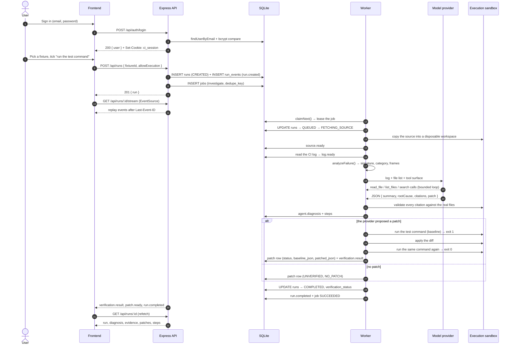
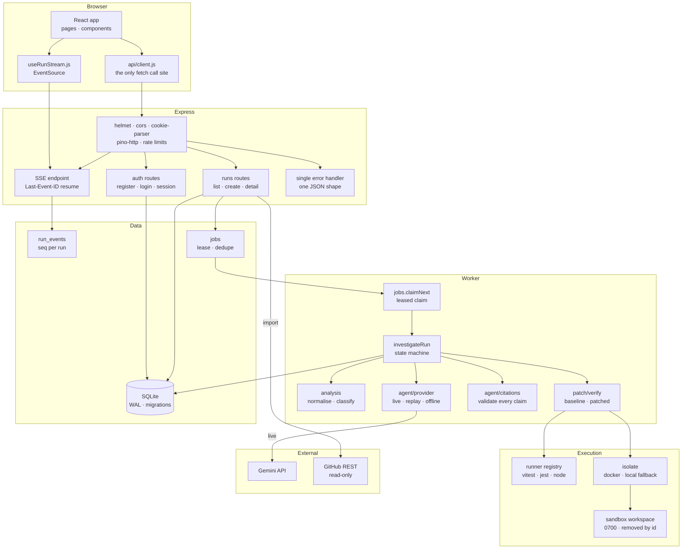
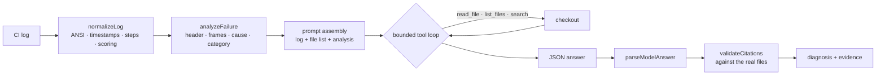
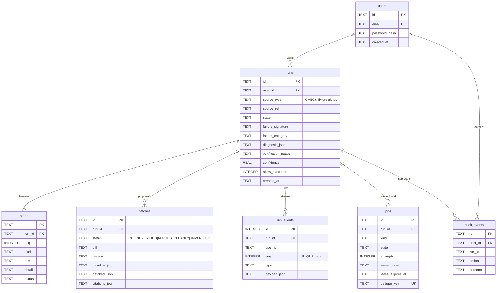

# CI Investigator

**An agent that reads a failed CI run, explains what broke, and proposes a patch — where the backend decides whether any of it is true.**

The model never sets the "fixed" flag. A diagnosis is presented as evidence-backed only when every citation it makes resolves to a real file and a real line in the real checkout. A patch is called `VERIFIED` only after the project's own failing command has been run twice in an isolated environment — once before the patch and once after — and failed, then passed.

That asymmetry is the whole product. A language model is good at forming a hypothesis and bad at knowing whether it is right, so the code that trusts it is kept deliberately small, and everything it says is checked against the machine.

```
   the model                the backend decides
  ┌────────────┐           ┌───────────────────────┐
  │ a claim    │ ────────▶ │ log · files · exit    │
  │ a diff     │           │ codes                 │
  └────────────┘           └───────────┬───────────┘
                                        │
                        VERIFIED · APPLIES_CLEANLY · UNVERIFIED
```

---

## Table of contents

1. [Introduction](#1-introduction)
2. [Key features](#2-key-features)
3. [Application workflow](#3-application-workflow)
4. [System architecture](#4-system-architecture)
5. [Codebase structure](#5-codebase-structure)
6. [The AI and diagnostic engine](#6-the-ai-and-diagnostic-engine)
7. [Database and data flow](#7-database-and-data-flow)
8. [API reference](#8-api-reference)
9. [Installation and local setup](#9-installation-and-local-setup)
10. [Configuration reference](#10-configuration-reference)
11. [Testing and evaluation](#11-testing-and-evaluation)
12. [Security architecture](#12-security-architecture)
13. [Technology stack](#13-technology-stack)
14. [License and contributing](#14-license-and-contributing)

---

## 1. Introduction

### The problem

A CI failure arrives as a wall of log output. The engineer who has to deal with it has to read the log, find the frame that points into their own code, work out which of the twenty possible causes applies, fix it, and prove the fix by running the suite again. Most of that work is mechanical, and all of it is slow.

The tempting shortcut is to hand the log to a language model and accept what comes back. The problem with that shortcut is that the model is a fluent narrator: it produces a confident, well-formatted explanation that may point at the wrong file, quote a line that does not exist, or assert a fix it never ran. The output looks exactly like a correct answer, which is what makes it dangerous.

### The approach

CI Investigator inverts the trust relationship. The model is a *proposer*; the backend is the *arbiter*. Three mechanisms enforce that:

| Claim | How the backend checks it |
|---|---|
| "The fault is in `src/cart.js` line 4, and that line says `sum += item.price;`" | The citation validator re-reads the checkout. The file must exist, the line must be in range, and the quoted text must actually be on that line. Anything else is reported as a rejected citation rather than quietly dropped. |
| "The failure is a broken assertion, not a broken environment" | Failure classification runs on the log itself and can answer *"no repository edit will change this"*. |
| "This patch fixes it" | The diff is applied to a fresh checkout, and the project's own test command is run before and after. The exit codes decide, not the diff. |

The result is a system whose output can be trusted in the specific sense that every claim in it has been mechanically confirmed or explicitly labelled as unconfirmed.

### Who it is for

- **Engineers on call** who need the shape of a failure — the failing file, the failing assertion, the reason — in under a minute rather than in a log-reading session.
- **Teams with a large queue of intermittent CI failures**, where the expensive part is triage rather than fixing.
- **Reviewers of AI-assisted changes**, who need to know which parts of a proposed diagnosis rest on evidence and which parts do not.

### Technology stack

| Layer | Stack |
|---|---|
| Frontend | React 18, React Router 6, TanStack Query 5, Vite 5, hand-written CSS design tokens, Vitest + Testing Library |
| Backend | Node 20+, Express 4, better-sqlite3 11, zod, pino, helmet, cookie-parser, express-rate-limit, jsonwebtoken, bcryptjs |
| AI | `@google/genai` (Gemini), a bounded tool-calling loop, an on-disk record/replay cache |
| Execution | `tar` for archives, `diff` for patches, Node's `child_process` with `shell: false`, optional Docker isolation |
| Data | SQLite with WAL, forward-only migrations, one repository per table |
| Integration | GitHub REST API (read-only), Server-Sent Events |

---

## 2. Key features

### 2.1 CI failure investigation

A run is a first-class, persistent object with an explicit state machine. Every transition is validated: an illegal move throws instead of being papered over, so the UI cannot show a state the backend never reached.

```
CREATED → QUEUED → FETCHING_SOURCE → INVESTIGATING → COMPLETED
                ↘        ↘                ↘              ↘
                 FAILED   FAILED          FAILED         FAILED
```

The vocabulary lives in one place (`backend/src/domain/runState.js`) as a transition table, and the same states are rendered by `StatusBadge` in the frontend.

**How a user interacts with it:** the dashboard lists the signed-in account's runs with their state, failure signature and category; each row links to the run detail page.

**Internally:** `runs.updateRunState()` calls `assertTransition()` inside the repository, so an illegal transition is a thrown `Error` with `code = 'ILLEGAL_TRANSITION'` rather than a silently corrupted row.

### 2.2 CI log ingestion and preprocessing

Logs arrive in whatever shape the provider produced. The normalisation layer turns them into something a parser and a model can both work with.

- ANSI escape sequences and cursor-movement codes are stripped — a colour code must not be able to reorder the text.
- Leading timestamps (ISO, bracketed ISO and bare `HH:MM:SS`) are removed, so two runs of the same job produce comparable text.
- Output is segmented into steps (`##[group]` / `##[endgroup]`) and into jobs (`##[group]Run <job>`).
- Every line is scored by an error-signal table (exception headers 100, compiler errors 100, assertion failures 95, `##[error]` 90, warnings 25–30, deprecation noise 10) and the highest-scoring lines are kept with a six-line context window around each.
- The excerpt is capped at 400 lines / 24 000 characters and secrets are redacted before it is handed on.

**Where it lives:** `backend/src/analysis/logNormalize.js`.

### 2.3 Error classification and failure categorisation

Every log is classified into exactly one of eleven categories. The category is not decoration — it decides the remedy, and one of the categories exists specifically to say that no repository edit will help.

| Category | Recognised by (examples) |
|---|---|
| `test_assertion` | `AssertionError`, `expected … but`, `Expected values to be strictly equal` |
| `runtime_error` | `TypeError`, `ReferenceError`, `RangeError` |
| `syntax_error` | `SyntaxError`, `Unexpected token`, `Unexpected end of input` |
| `missing_dependency` | `Cannot find package`, `ModuleNotFoundError`, `ERR_MODULE_NOT_FOUND` |
| `import_error` | `does not provide an export named`, `ImportError` |
| `compile_error` | `error TS…`, `cannot find symbol`, `.java:[…,]` |
| `build_failure` | `BUILD FAILURE`, `ninja: build stopped`, `Makefile…Error` |
| `lint_failure` | `eslint`, `ruff`, `flake8`, `golangci-lint` |
| `environment` | `ECONNREFUSED`, `ETIMEDOUT`, `EACCES`, `out of memory` |
| `timeout` | `timed out after … ms`, `exceeded` |
| `unknown` | nothing matched |

**Why the environment category matters:** fixture `08-undiagnosable` fails with `ECONNREFUSED` inside perfectly correct code. Classifying it as `environment` is what stops the system from proposing a patch to code that is not broken.

**Where it lives:** `backend/src/analysis/failure.js` — `classifyFailure()` walks an ordered rule table, so the first matching rule wins and the ordering encodes precedence.

### 2.4 AI-assisted diagnosis

The model receives the CI log, the list of repository files, and three tools it can call: `read_file`, `list_files` and `search`. The loop is bounded — 16 tool calls and 8 steps — and every path the model names is resolved inside the checkout before anything is opened.

The model answers with a JSON object: a summary, a root cause, a category, a confidence, a list of citations, a suggested fix and a unified diff.

**Three providers, one interface:**

| Provider | Selected when | Behaviour |
|---|---|---|
| `live` | `LLM_MODE=live` and a key is configured | Calls Gemini with the bounded tool loop. Transient failures (408/429/5xx) are retried with a growing delay, then the configured fallback model is tried once. |
| `replay` | `LLM_MODE=replay` (the default) | Serves a recorded response from `fixtures/recordings/` or the runtime cache. A recording whose log hash does not match is replayed with a warning. |
| `offline` | No recording matches | A built-in heuristic reasoner. It localises the fault and quotes the line. It never proposes a patch, because writing the fix is the one thing a heuristic genuinely cannot do. |

**Where it lives:** `backend/src/agent/provider.js`.

### 2.5 Source-code evidence and citation validation

This is the mechanism that makes the model's output checkable.

A citation is a statement of the form *"the fault is in `src/cart.js` at line 4, and that line says `sum += item.price;`"*. It is accepted only when all of the following hold:

1. the file exists inside the checkout,
2. the line number is in range and the line is not blank,
3. the quoted text is contained in that line.

Six outcomes are possible, and all six are surfaced in the UI rather than collapsed into "valid" or "invalid":

| Status | Meaning |
|---|---|
| `SUPPORTED` | The file, the line and the quote all check out. |
| `MISSING_FILE` | No such file in the checkout. |
| `OUTSIDE_CHECKOUT` | The path resolves outside the checkout root. |
| `WRONG_LINE` | The line number is past the end of the file. |
| `BLANK_LINE` | The line exists but is empty. |
| `WRONG_QUOTE` | The line does not contain the quoted text. |

**Where it lives:** `backend/src/agent/citations.js`. The run detail page renders each citation next to the reason it was accepted or rejected.

### 2.6 Root-cause identification

Root cause is derived from three independent signals, and the strength of each is visible:

- **The error header** — the exception type and message, extracted with a multi-line-aware parser.
- **The stack frames** — parsed structurally (`at fn (file:line:col)`), then relativised against the checkout roots. Frames that point into Node internals are separated from frames that point into the repository, and the first repository frame is the candidate.
- **The wrapped cause** — `TypeError: fetch failed` says almost nothing; the `[cause]: Error: connect ECONNREFUSED` line below it says exactly what happened. The cause is extracted and folded into the signature as `TypeError: fetch failed [ECONNREFUSED]`.

When no frame points into the repository — which is what a syntax error produces, because the module never compiled — the parser falls back to the file reference printed immediately above the error, and reports `evidenceSource: 'file-reference'` so the weaker evidence is visible as such.

**Where it lives:** `backend/src/analysis/failure.js` (`analyzeFailure`, `parseFrameLine`, `relativizePath`).

### 2.7 Patch application and verification

A proposed diff is applied to a fresh copy of the checkout and then judged by running the project's own test command twice.

| Situation | Status | Reason code |
|---|---|---|
| The diff cannot be applied safely | `UNVERIFIED` | `PATCH_DID_NOT_APPLY` |
| No test command could be resolved | `APPLIES_CLEANLY` | `UNSUPPORTED_ECOSYSTEM` |
| Execution is not permitted | `APPLIES_CLEANLY` | `EXECUTION_DISABLED` |
| Dependency installation failed | `APPLIES_CLEANLY` | `SETUP_FAILED` |
| The baseline run timed out | `APPLIES_CLEANLY` | `BASELINE_TIMEOUT` |
| The baseline run already passed | `APPLIES_CLEANLY` | `BASELINE_ALREADY_PASSING` |
| The patched run timed out | `APPLIES_CLEANLY` | `PATCHED_TIMEOUT` |
| The patched run still failed | `APPLIES_CLEANLY` | `PATCHED_FAILED` |
| The patch changes a test file | `UNVERIFIED` | `PATCH_MODIFIES_TESTS` |
| The baseline failed and the patched run passed | `VERIFIED` | — |

The baseline and the patched run use the *identical* argv. Both exit codes are persisted with the patch, so the claim can be re-read later rather than taken on trust.

A patch that changes a **test file** is refused. The test is what the result is measured against, so a patch that rewrites the test to make it pass would turn "the fix works" into "the test was rewritten" — a `VERIFIED` that means nothing. The status is `UNVERIFIED` with the reason `PATCH_MODIFIES_TESTS`.

**How the user interacts with it:** the run detail page shows the verification badge, the reason the backend gave, the diff, and the timeline. The "run this project's test command" checkbox on the dashboard is the per-run half of the execution consent.

**Where it lives:** `backend/src/patch/apply.js` (containment and all-or-nothing application) and `backend/src/patch/verify.js` (the decision table).

### 2.8 Test-runner discovery

The runner never hardcodes `npm test`. A checkout is arbitrary third-party content: it may be a Vitest project, a Jest project, a Node project using the built-in runner, or a package with only a `test` script. Running the wrong command produces either a false "everything passes" or a log full of errors unrelated to the failure under investigation.

Four adapters are tried in priority order, and the first one that both recognises the project and can name a command wins:

| Priority | Adapter | Command it resolves |
|---|---|---|
| 10 | `vitest` | `npx --no-install vitest run` (requires `vitest` in the manifest) |
| 20 | `jest` | `<package-manager> test` (requires `jest` in the manifest and evidence the suite runs through Jest) |
| 30 | `node-test-runner` | `node --test --test-reporter=spec` |
| 40 | `node-npm-test` | `<package-manager> test` (the fallback) |

Adapters produce *plans*, never executions. A plan is an argv array — never a shell string — and the plan factory refuses a string outright, because the moment anyone reassembles an argv into a string, `;` and `$(...)` come back to life.

**Where it lives:** `backend/src/runner/registry.js` and `backend/src/runner/adapters/`.

### 2.9 Isolated execution

Running a checkout means running somebody else's code. A scratch directory contains the *paths*; it does not contain the *process*.

When a Docker daemon is reachable, the command runs inside a container with:

```
docker run --rm --network none --read-only --cap-drop ALL
  --security-opt no-new-privileges
  --memory 512m --cpus 1 --pids-limit 256
  --tmpfs /tmp:rw,noexec,nosuid,size=64m
  --volume <checkout>:/workspace:ro --workdir /workspace
  <image> <argv…>
```

No network, a read-only root filesystem, every capability dropped, and only the checkout mounted. When no Docker daemon is reachable the runner falls back to the local sandbox, and **the result records which one produced it** (`isolation: 'docker'` or `'local'`), so a verification result always says what executed it.

Both paths spawn with `shell: false`, pass a scrubbed environment, cap the captured output at 2 MiB, and kill the child on timeout.

**Where it lives:** `backend/src/runner/isolate.js` and `backend/src/runner/execute.js`.

### 2.10 GitHub Actions integration

A failed GitHub Actions run can be imported by pasting its URL. The import is read-only by construction — the client has exactly four methods and none of them writes.

| Call | Endpoint |
|---|---|
| Workflow run metadata | `GET /repos/{owner}/{repo}/actions/runs/{id}` |
| The run's jobs | `GET /repos/{owner}/{repo}/actions/runs/{id}/jobs` |
| A job's log (plain text) | `GET /repos/{owner}/{repo}/actions/jobs/{id}/logs` |
| The source archive (gzipped tar) | `GET /repos/{owner}/{repo}/tarball/{ref}` |

Only `https://github.com/<owner>/<repo>/actions/runs/<numeric id>` is accepted, and the owner and repository are matched against GitHub's own naming rules, so a crafted URL cannot make the client talk to another host. The failing job is selected automatically; a run whose job concluded successfully is refused, because there is no failure to investigate.

The downloaded archive goes through the same two-pass validation as every other archive — validated in full before a single byte is written.

Imports are **off unless `GITHUB_MODE=live`**. The default, `replay`, means nothing leaves the machine, so an import is refused with an explanation rather than quietly calling the API.

A `GITHUB_TOKEN` is **required for an import to complete**, and not because the repository is private. GitHub lets an anonymous caller read a run's metadata, its jobs and its source archive, but it refuses the *job log* with a 403 — and the log is the thing the whole investigation is about. The token needs no scopes beyond `actions:read` for a public repository, and `repo` for a private one.

**Where it lives:** `backend/src/github/client.js` and `backend/src/github/import.js`.

### 2.11 Real-time investigation updates

The run detail page updates live while an investigation is running. The transport is Server-Sent Events, and the events are rows in the database with per-run sequence numbers rather than in-memory messages — which is what makes the stream resumable and durable across a server restart.

A browser that drops its connection reconnects with `Last-Event-ID: <n>`, and the server replays every event after that sequence number before the live tail continues.

**Where it lives:** `backend/src/routes/runs.js` (the endpoint) and `frontend/src/hooks/useRunStream.js` (the client).

### 2.12 Investigation history and persistent storage

Every run, every timeline step, every patch, every event and every audit record is persisted in SQLite. The dashboard is a query over that history, scoped to the signed-in account.

### 2.13 Authentication and per-user data isolation

Sessions are HttpOnly, `SameSite=Lax` cookies carrying a signed JWT that holds nothing but a user id. Every protected request re-reads the user row, so deleting an account invalidates its sessions immediately.

Isolation is enforced in SQL, not in JavaScript: every run read and write carries `user_id` in its `WHERE` clause. A run belonging to somebody else answers `404`, not `403` — the difference in status codes would otherwise confirm that an id exists.

---

## 3. Application workflow

### 3.1 End-to-end sequence



### 3.2 What happens, in order

1. **Authentication.** The client posts credentials; the backend spends a bcrypt comparison whether or not the account exists, so the response time does not reveal it. Success sets an HttpOnly session cookie.
2. **Starting a run.** The client posts a fixture id (or a GitHub run URL) and the execution consent. The backend creates the run, records a `run.created` event and enqueues an `investigate` job with a dedupe key, so a double submit cannot start two investigations of the same run.
3. **The stream opens.** The run detail page opens an `EventSource`. The server replays everything after the last event the client saw, then polls for new events every 700 ms and sends a heartbeat comment every 15 s.
4. **The worker claims the job.** A conditional `UPDATE` inside a transaction leases it. Two workers racing for the same row cannot both win: the loser sees a zero row count and moves on. Leases expire, so a worker killed mid-job does not strand the job.
5. **The source is checked out** into a disposable workspace created with mode `0700` under the sandbox root, and removed by id when the run ends.
6. **The log is loaded** and normalised.
7. **The failure is analysed** — error header, category, stack frames, wrapped cause, stable signature.
8. **The model is asked.** In `replay` mode a recorded answer is served; in `live` mode the tool loop runs against Gemini. Either way the answer has the same shape.
9. **Every citation is validated** against the checkout, and the verdicts are stored with the diagnosis.
10. **The patch is put to the test.** If a diff was proposed, the test command runs on the unmodified checkout, the diff is applied, and the identical command runs again. The two exit codes decide the status.
11. **The result is persisted** and streamed. The frontend refetches the run and renders the diagnosis, the evidence, the diff, the log and the timeline.

---

## 4. System architecture



### Layer responsibilities

**Frontend.** One HTTP exit point. `api/client.js` is the only module that calls `fetch`; the only module that constructs an `EventSource` is the stream hook, and it uses the URL the client exports. That rule exists for two reasons: the session cookie has to be attached and the 401 handling has to be uniform, and there has to be exactly one place to look when the API contract changes.

**Express API.** Thin by design. It validates input with zod, enforces authentication and ownership, and delegates everything else. The error handler is the single place that turns a thrown error into a response body, so a client never has to guess whether it received HTML or JSON.

**Worker.** The only component that writes analysis results. It claims one job at a time and drives the run state machine. Every step it records is written twice — once to `steps` (the timeline the UI renders) and once to `run_events` (the stream the UI subscribes to) — so the live view and the stored history are the same data.

**Model provider.** A proposer behind a narrow interface. Whether it is the live model, a recording or the offline reasoner, its output goes through the same validators. A live model gets no special trust.

**Execution sandbox.** Where the verdict is produced. The runner registry decides *what* to run, the executor decides *how*, and the isolation layer decides *where*.

**SQLite.** The source of truth for state, and the transport for the event stream.

### Communication patterns

| From | To | Mechanism |
|---|---|---|
| Browser | API | `fetch` with `credentials: 'include'`, JSON in and JSON out |
| Browser | API | `EventSource` over `/api/runs/:id/stream`, named events with an `id:` per frame |
| API | SQLite | Synchronous better-sqlite3 calls; the API and the worker share one connection |
| Worker | SQLite | The same connection; claims are leased, so a second process cannot double-process |
| Worker | Model | One HTTP request per step, with the tool loop bounded |
| Worker | Sandbox | `spawn` with `shell: false`, argv array, timeout, output cap |
| API | GitHub | `fetch`, four read-only endpoints, optional bearer token |

---

## 5. Codebase structure

```text
ci-investigator/
├── backend/
│   ├── src/
│   │   ├── app.js                     Express app: middleware stack, routes, error handler
│   │   ├── server.js                  Listener, boot recovery, graceful shutdown
│   │   ├── worker.js                  Job consumer: the investigation pipeline
│   │   ├── config.js                  Every environment variable, validated once with zod
│   │   ├── server.js                  Listener, boot checks, graceful shutdown
│   │   ├── logger.js                  pino instance with credential redaction
│   │   ├── agent/
│   │   │   ├── provider.js            live / replay / offline providers, the tool loop
│   │   │   ├── citations.js           The citation validator
│   │   │   └── offlineReasoner.js     The no-API-key fallback reasoner
│   │   ├── analysis/
│   │   │   ├── logNormalize.js        ANSI/timestamp stripping, segmentation, scoring
│   │   │   └── failure.js             Error header, frames, cause, category, signature
│   │   ├── patch/
│   │   │   ├── apply.js               Diff application with containment
│   │   │   └── verify.js              The verification decision table
│   │   ├── runner/
│   │   │   ├── registry.js            Adapter selection
│   │   │   ├── execute.js             The local sandboxed executor
│   │   │   ├── isolate.js             The container runner and its fallback
│   │   │   └── adapters/              Four Node test-runner adapters and the plan types
│   │   ├── sandbox/
│   │   │   ├── workspace.js           Disposable workspaces
│   │   │   └── checkout.js            Listing, reading and searching a checkout
│   │   ├── security/
│   │   │   ├── paths.js               Path containment and file classification
│   │   │   ├── archive.js             Two-pass archive validation and extraction
│   │   │   └── redact.js              Secret redaction
│   │   ├── github/
│   │   │   ├── client.js              The read-only REST client
│   │   │   └── import.js              The import service
│   │   ├── auth/
│   │   │   ├── passwords.js           bcrypt hashing and comparison
│   │   │   ├── tokens.js              JWT signing and the session cookie
│   │   │   ├── middleware.js          requireAuth, optionalAuth, loadOwnedRun
│   │   │   └── routes.js              Register, login, logout, session
│   │   ├── db/
│   │   │   ├── index.js               Connection, pragmas, test database
│   │   │   ├── migrations.js          The schema and its indexes
│   │   │   └── repos/                 One repository per table
│   │   ├── domain/
│   │   │   ├── runState.js            The run state machine
│   │   │   └── patchStatus.js         The three verification statuses and their reasons
│   │   ├── fixtures/catalog.js        Access to the fixture definitions
│   │   ├── http/errors.js             The error type the API speaks
│   │   └── routes/runs.js             The run API and the event stream
│   └── test/                          Seven suites
├── frontend/
│   ├── index.html
│   ├── vite.config.js
│   └── src/
│       ├── main.jsx                   Query client, providers, mount
│       ├── App.jsx                    Routes and the protected-route wrapper
│       ├── constants.js               The shared domain vocabulary
│       ├── api/client.js              The only HTTP exit point
│       ├── auth/AuthContext.jsx       Session bootstrap and the auth mutations
│       ├── hooks/useRunStream.js      The live event stream
│       ├── components/                The presentation widgets
│       ├── pages/                     Login, Register, Dashboard, RunDetail, SessionExpired
│       ├── utils/format.js            Presentation helpers
│       ├── styles/                    Design tokens and the stylesheet
│       └── __tests__/                 Five suites
├── fixtures/
│   ├── definitions/                   Eight failing projects, one readable file each
│   ├── expected.json                  Hand-written ground truth
│   ├── recordings/                    Recorded model responses
│   ├── scripts/                       seed.js, capture.js, check.js, paths.js
│   └── README.md
├── eval/run-eval.js                   The evaluation harness
├── scripts/
│   ├── check-all.js                   Every check, one PASS/FAIL table
│   └── setup-env.js                   Creates the local environment files
├── deploy/nginx.conf                 Serves the bundle and proxies /api
├── Dockerfile                         The backend image
├── frontend/Dockerfile                The frontend image
├── docker-compose.yml                 The whole application, one host
├── package.json
└── README.md
```

### Backend

#### `src/app.js` — the Express application

`createApp({ db, limiters })` builds the app without starting a listener, so tests can drive it with supertest.

Middleware order matters and is deliberate: `helmet` (with the CSP disabled explicitly, because the frontend is a separate origin in development) → `cors` (an origin *function*, so an origin that is not on the allow list gets no CORS headers at all, and credentials are enabled so the cookie works) → `express.json({ limit: '256kb' })` → `cookieParser()` → `pino-http` → a 300-per-minute rate limit mounted on `/api`.

The error handler at the bottom is the only place an error becomes a response. An `ApiError` carries its own status and code; a malformed body is a 400; an oversized body is a 413; anything else is logged with its stack and reported as a generic 500 without leaking internals.

#### `src/server.js` — the process lifecycle

`startServer()` builds the app, runs boot recovery (`jobs.recoverStaleJobs`, which requeues jobs whose lease expired because the process died), starts the worker and listens. `SIGINT`/`SIGTERM` stop the worker, close the server and close the database, with a ten-second watchdog so a stuck connection cannot hang the shutdown.

#### `src/worker.js` — the investigation pipeline

`investigateRun(db, { runId, userId, overrides })` is one run, start to finish; `startWorker()` is the polling loop that claims jobs.

The pipeline is: queue → fetch the source → load the log → analyse → diagnose → validate the citations → verify the patch → persist → complete. Each phase records a timeline step *and* an event, and every state change goes through `assertTransition`.

The `overrides` object (`sourceDir`, `logPath`, `globalExecutionAllowed`) exists so the pipeline can be driven against a temporary checkout in a test without depending on generated artefacts.

#### `src/agent/provider.js` — the model boundary

`createProvider()` picks the implementation; `createLiveProvider()` runs the bounded tool loop; `createReplayProvider()` serves recordings; `createOfflineProvider()` is the heuristic fallback.

The tool loop is the interesting part. The model asks for tools; the executor answers them with the checkout's contents, refusing any path that resolves outside the checkout. The model's turn is echoed back *verbatim*, because the parts carry a `thoughtSignature` the API requires — rebuilding the parts from `functionCalls` alone loses it and the request is rejected. The turn structure has to alternate, ending on a user turn, and when the budget is nearly spent the model is told to stop exploring and answer.

`parseModelAnswer()` accepts raw JSON, JSON in a code fence, or JSON embedded in prose, and returns an empty diagnosis rather than throwing when the answer is unusable.

#### `src/agent/citations.js` — the citation validator

`validateCitation(citation, { checkoutRoot })` resolves the path against the checkout root (so a citation cannot point outside it), reads the file, and checks the line and the quote. `validateCitations()` returns the per-citation verdicts plus a summary. The result is stored with the diagnosis and rendered in the UI.

#### `src/analysis/failure.js` — the failure parser

`analyzeFailure(rawLog, { roots })` returns the error name, code, message, stable signature, category, every frame, the repository frames, the first repository frame, the suspected file and line, the evidence source, the failing tests and a one-line summary.

Two details are worth naming. `relativizePath` refuses to present a path outside the checkout as repository-relative — it marks it external instead, so the model is never told `src/server.js` when the frame actually pointed into `/usr/lib`. And `buildSignature` appends the second line of a message that ends in a colon, because "Expected values to be strictly equal:" does not identify a failure but "350 !== 1200" does.

#### `src/patch/apply.js` — applying a diff

`applyUnifiedDiff(diffText, { checkoutRoot, readFile, writeFile })` plans every path first, then writes. If one file of a multi-file diff does not apply, the files already written are restored, so a checkout is never left half-patched for a later baseline run to measure.

`repairHunkHeaders()` rewrites a hunk header whose count disagrees with its own body — the shape a model actually produces. The repair only runs after a normal parse has already failed, so a well-formed diff is never touched.

#### `src/patch/verify.js` — the verdict

`verifyDiff()` is the decision table in section 2.7. It resolves the test command, applies the diff, runs the baseline, applies the diff for real, runs the identical command again and persists both exit codes.

Two consents gate execution: `globalExecutionAllowed` (`ALLOW_REPO_EXECUTION`) and `executionAllowed` (the per-run consent from the UI). Without both, the engine stops at "applies cleanly" and says why.

#### `src/runner/registry.js` and `src/runner/adapters/`

The registry tries adapters in priority order. Each adapter answers two questions: *do I recognise this project* (`detect`) and *what command does it run* (`resolvePlan`). A plan carries the argv, the install step, the install policy and a human-readable rendering, and it is deep-frozen.

`types.js` is where the safety rules live: `assertSafeArgv` refuses a string outright and refuses any token carrying a shell metacharacter; `assertSafeRepoPath` refuses absolute paths, `..` segments and a leading `-` (which would turn a filename into a flag); `capTargets` widens to the whole suite rather than silently running a truncated subset.

#### `src/runner/execute.js` and `src/runner/isolate.js`

`execute.js` runs a command in the local sandbox: argv array, `shell: false`, a scrubbed environment (`HOME` is the checkout, `PATH` is fixed, `CI=1`), a 2 MiB output cap and a timeout that kills the child.

`isolate.js` runs the same command inside a container, and falls back to `execute.js` when no Docker daemon is reachable. The result always carries `isolation`, and `verify.js` persists it with the exit codes.

#### `src/sandbox/workspace.js` and `src/sandbox/checkout.js`

`workspace.js` creates the disposable checkout (`mkdtemp` under the sandbox root, mode `0700`) and removes it by id. `removeWorkspace` requires an `expectedId`: without it the call is refused, because that argument is what stops a delayed cleanup from deleting a different run's checkout. The containment check is repeated through `realpath` at delete time, so a symlinked sandbox root cannot redirect the delete.

`checkout.js` is how the rest of the system sees a checkout: a filtered file listing (dependency directories, secret-looking files and binaries excluded), a contained reader, and a regex search.

#### `src/security/paths.js`, `archive.js`, `redact.js`

`paths.js` is the containment layer: `resolveInside` refuses absolute paths, `..` segments and null bytes; `resolveRealInside` follows symlinks and re-checks; `readTextFileInside` enforces a byte cap and requires a regular file. It also classifies paths — `isSecretPath` (tested against both the full path and the basename, so `config/.env.local` is caught), `isBinaryPath`, `isExcludedPath`.

`archive.js` extracts in two passes: the first reads and validates every entry — path length, absolute paths, `..` segments, resolved escapes, depth, symlinks, entry count, per-file size and total decompressed size — and writes nothing; the second extracts, writing only the allowlisted entries. The decompressed size is measured on the gunzip stream, so a decompression bomb is rejected mid-flight rather than absorbed.

`redact.js` scrubs private keys, GitHub tokens, Gemini keys, AWS key ids, Slack tokens, authorization headers, credential assignments, URL credentials and JWTs, and truncates the result. `registerSecret()` adds a value to be scrubbed wherever it appears.

#### `src/github/client.js` and `import.js`

The client is four read-only endpoints and a URL parser. The archive is buffered (capped at 100 MiB) and returned as a *factory*, because the extraction code has to read it twice — once to validate, once to extract.

`import.js` chooses the failing job, downloads the log, downloads the archive, extracts it into a workspace and returns the checkout path and the log text. The run stores both, so the worker does not need to know where they came from.

#### `src/db/` — the data layer

`index.js` opens the connection with `journal_mode = WAL`, `foreign_keys = ON`, `busy_timeout = 5000` and `synchronous = NORMAL`. WAL means a long read (a UI listing runs) never blocks the worker's write; foreign keys are on because SQLite defaults them off, which would make every `ON DELETE CASCADE` decorative.

`migrations.js` holds the schema. Each migration runs in its own transaction together with its `schema_migrations` row.

The repositories are one per table, and they are where ownership scoping lives: `runs.getRun(db, userId, runId)` is `WHERE id = ? AND user_id = ?`, `listRuns` filters in SQL, and `toPublicRun` deliberately omits `checkout_path` (a server filesystem path the UI has no business knowing) and `diagnosis_json` (which has its own route).

#### `src/domain/` — the vocabulary

`runState.js` is the transition table; `patchStatus.js` owns the three statuses and the fourteen reason strings, so the verification service, the repository and the UI cannot drift apart.

#### `src/auth/`

`passwords.js` uses bcrypt at cost 10 (4 under test) and treats a malformed hash as "wrong password" rather than a 500. `tokens.js` signs a JWT carrying only the user id, and sets the cookie with `httpOnly`, `sameSite: 'lax'` and `secure` in production. `middleware.js` holds `requireAuth` (which re-reads the user row on every request), `optionalAuth`, and `loadOwnedRun` — the single most important authorisation check in the app, because the client controls the run id. `routes.js` has the three credential endpoints with their own, tighter rate limits.

### Frontend

#### `src/main.jsx` and `src/App.jsx`

`main.jsx` creates the query client (retries are off: every failure mode in this app is worth showing verbatim, and blind retries only delay the message) and mounts the providers. Mounting is skipped when `import.meta.env.VITEST` is set, so a test can import `App` without a global mount.

`App.jsx` defines the routes and the `RequireAuth` wrapper. A protected route is not rendered for an anonymous visitor; the check lives in one place rather than in each page.

#### `src/api/client.js`

`request(path, options)` is the pipeline: `credentials: 'include'`, a JSON body when there is one, `AbortError` passed through untouched, a transport failure turned into a `network_error`, and a non-2xx turned into an `ApiError` carrying the status, the server's error code and the validation issues.

A 401 from a protected endpoint announces itself through `onUnauthorized`, so the app can drop the session and send the user to the "session expired" screen. A 401 from `/auth/login` does **not** — that is an answer, not an expiry, and treating it as one would log the user out while they mistype their password.

#### `src/auth/AuthContext.jsx`

The session is bootstrapped once, by a query against `/auth/session`; a 401 becomes `null` ("not signed in" is a normal state, not a failure to report). `setUser` clears the `runs`, `run` and `system` query families so one account's data can never be shown to another. `logout` clears the cookie and the whole cache.

#### `src/hooks/useRunStream.js`

Opens one `EventSource` per run and subscribes to all eighteen event types by name, because the server sends named events rather than anonymous messages. The browser's own reconnect logic handles the resume; the hook only opens and closes the stream.

#### `src/pages/`

`Dashboard.jsx` lists the runs and holds the "start an investigation" form — the fixture picker and the execution-consent checkbox. `RunDetail.jsx` renders the diagnosis, the evidence with each citation's verdict, the diff, the CI log and the timeline, and refetches whenever the stream says something changed. `Login.jsx`, `Register.jsx` and `SessionExpired.jsx` handle the session.

#### `src/components/`

`DiffView.jsx` contains a pure unified-diff parser (`parseUnifiedDiff`) that returns files, hunks and rows; the renderer colours them. `LogExcerpt.jsx` renders CI output as text — never as HTML — and collapses a long log behind a button. `VerificationBadge.jsx` renders the status the backend decided; it has no code path that could produce `VERIFIED`. `StatusBadge.jsx` maps the eleven run states onto labels and tones. `EmptyState.jsx` and `Spinner.jsx` are the small states. `AppShell.jsx` is the top bar and the page frame.

#### `src/utils/format.js` and `src/constants.js`

The formatting helpers are pure. `constants.js` is the frontend's copy of the backend's vocabulary, and it deliberately contains **no** helper that derives a verification status from a patch, a diff or a model output — the UI can label a decision, but it cannot make one.

#### `src/styles/`

`tokens.css` is a single `:root` block: surfaces, accent, text, borders, four semantic colour families, diff colours, log colours, an eight-step spacing scale, radii, type, elevation and motion. `app.css` is the stylesheet, one class family per concern. No component invents a hex value.

---

## 6. The AI and diagnostic engine

The system has two kinds of reasoning, and keeping them apart is the point.

**Deterministic, in the backend, and not negotiable:**

- the log normalisation and the failure classification;
- the citation validation, which re-reads the checkout;
- the diff application, which resolves every path against the checkout root;
- the test run, and the two exit codes it produces.

**Probabilistic, in the model:**

- which file and line the fault is in;
- what the failure means in plain language;
- what the fix should be;
- the diff that implements it.

The model's output is never trusted because it is well-formed. It is either confirmed by the deterministic layer or shown with the confirmation attached.

### How the log reaches the model



The prompt carries the normalised log (capped at 40 000 characters), the repository's file list, the analyser's own classification and signature, and the tool declarations. The system instruction fixes the answer's shape — one JSON object with named keys — and states the citation contract explicitly: every citation must name a file that exists, a line that exists in it, and quote that line exactly.

### How citations are checked

The validator never trusts the path it is given. It resolves it against the checkout root and re-checks, so `../../etc/passwd` is `OUTSIDE_CHECKOUT` rather than a read. It then reads the file, checks the line is in range and not blank, and checks that the quoted text is contained in that line. A citation that quotes a *fragment* of the line is accepted; a citation that quotes something the line does not contain is rejected.

### How uncertain and environmental failures are handled

The classifier can answer `environment`, and the offline reasoner's suggested fix for that category is "No code change will help: the environment the tests need is not available." A failure that cannot be reproduced in the checkout is `BASELINE_NOT_REPRODUCIBLE` rather than a verdict. A patch that cannot be applied safely is `UNVERIFIED`. In every case the system prefers a stated uncertainty to a confident wrong answer.

### How replay works

`LLM_MODE` defaults to `replay`. The replay provider searches two directories — the runtime cache (`config.llm.cacheDir`) and the shipped recordings in `fixtures/recordings/` — for a record whose `sourceRef` matches. An exact log-hash match wins; a recording made for different input is replayed with a warning rather than silently reused. With no recording, the offline reasoner answers.

This is what lets the whole pipeline, including the verification step, run with no API key and no network call — and it is why the test suite never depends on a model.

---

## 7. Database and data flow



### Tables

| Table | Purpose |
|---|---|
| `users` | Accounts. The password hash column is never selected into an API response. |
| `runs` | One investigation. Carries the source coordinates, the state, the failure classification, the diagnosis, the verification status and the execution consent. |
| `steps` | The investigation timeline: the source checkout, the log, the analysis, the diagnosis, the verification. |
| `patches` | Proposed patches with their status, the diff, the citations, and the two exit codes that produced the verdict. |
| `run_events` | The event stream. One row per event, with a per-run sequence number. |
| `jobs` | The durable queue: the job kind, its state, the attempt count, the lease and the dedupe key. |
| `audit_events` | The audit trail: who did what, with redacted metadata. |
| `webhook_deliveries` | Delivery ids, for webhook idempotency. |
| `schema_migrations` | Which migrations have been applied. |

Indexes cover the access paths that matter: `(user_id, created_at DESC)` and `(user_id, state)` on runs, `(run_id, seq)` on steps and events, `(state, available_at)` on jobs, and a unique index on `jobs.dedupe_key` where it is not null.

### How the data moves

**Ownership isolation.** Every run read and write carries `user_id` in its `WHERE` clause. The application never loads "all runs" and filters them in JavaScript — that is how cross-tenant leaks happen, and it does not scale past the demo dataset either.

**Event sequencing.** `appendEvent` allocates `seq = MAX(seq) + 1` inside a transaction, and a `UNIQUE (run_id, seq)` constraint backs it. Two concurrent emitters cannot produce the same sequence number even if they try. Payload sanitisation happens on the way in: strings are redacted and capped at 4 000 characters, arrays at 50 items, objects at 50 keys, and the depth is capped at four.

**The stream as storage.** Because events are rows rather than in-memory messages, the SSE endpoint can replay any suffix of the history, and the stream survives a server restart.

**The job queue.** `claimNext` selects a `QUEUED` job whose `available_at` has passed and whose lease is free, then claims it with a conditional `UPDATE … WHERE id = ? AND state = 'QUEUED'`. A zero row count means another worker won the race, and the loser returns `null` rather than processing the job twice. The database enforces the guarantee, not an in-process mutex that would not survive a restart.

---

## 8. API reference

All endpoints are under `/api`. Request and response bodies are JSON. Every endpoint except `/health` and `/system` requires the session cookie.

### Health and system

| Method | Endpoint | Auth | Purpose |
|---|---|---|---|
| `GET` | `/api/health` | none | Liveness probe. Returns `{ ok, service, time }`. |
| `GET` | `/api/system` | none | What the installation can currently do: the LLM and GitHub availability, and whether repository execution is permitted. |

### Authentication

| Method | Endpoint | Auth | Purpose |
|---|---|---|---|
| `POST` | `/api/auth/register` | none | Create an account. Body `{ email, password }`. Passwords are at least 10 characters. Returns `201 { user }` and sets the session cookie. `409` if the email is taken. Rate limited to 10 per hour. |
| `POST` | `/api/auth/login` | none | Exchange credentials for the session cookie. Returns `{ user }`. `401` with an identical message whether the account is unknown or the password is wrong. Rate limited to 20 per 15 minutes. |
| `POST` | `/api/auth/logout` | optional | Clear the session cookie and audit the logout. Returns `{ ok: true }`. |
| `GET` | `/api/auth/session` | required | The current user. `401` when the session is missing or invalid. |

### Investigations

| Method | Endpoint | Auth | Purpose |
|---|---|---|---|
| `GET` | `/api/runs` | required | The caller's runs. Query: `limit` (1–100, default 50), `offset` (default 0), `sort` (`created_at` \| `updated_at` \| `state`, default `created_at`). Returns `{ runs, total, limit, offset }`. |
| `POST` | `/api/runs` | required | Start an investigation. Body: `fixtureId` **or** `runUrl`, and `allowExecution` (default `false`). Returns `201 { run }`. The run is `CREATED` and a job is enqueued. |
| `GET` | `/api/runs/fixtures` | required | The fixtures available to investigate: `{ fixtures: [{ id, title, kind, fileCount }] }`. |
| `GET` | `/api/runs/:runId` | required | One run with its diagnosis, timeline and patches. `404` for a run belonging to another account. |
| `GET` | `/api/runs/:runId/stream` | required | The event stream (SSE). Resumes from the `Last-Event-ID` header or the `lastEventId` query parameter. |

### The event stream

The response is `text/event-stream`. Each frame is:

```
id: <sequence number>
event: <event type>
data: <json payload>

```

A comment frame (`: keep-alive`) is sent every 15 seconds to keep intermediaries from dropping an idle connection. The eighteen event types are `run.created`, `run.state`, `run.failed`, `job.queued`, `source.ready`, `log.ready`, `step.discovered`, `agent.started`, `agent.tool_call`, `agent.tool_result`, `agent.diagnosis`, `patch.ready`, `verification.started`, `verification.result`, `run.completed`, `log`, `tracking.updated` and `run.cancelled`.

### Error shape

Every error is the same JSON:

```json
{ "error": "run_not_found", "message": "No such run.", "issues": null }
```

`error` is a stable machine-readable code, `message` is safe to display, and `issues` carries per-field validation problems when there are any.

---

## 9. Installation and local setup

### Prerequisites

- **Node.js 20 or newer** (`node --version`). The project uses `node --test`, `fs.cp` and the built-in test runner.
- **npm 10 or newer** (ships with Node 20).
- Docker is optional. Without a reachable Docker daemon the execution layer falls back to the local sandbox, and the result records which one ran.

### Setup

```bash
git clone <repository-url>
cd ci-investigator
npm run setup
```

`npm run setup` does four things:

1. `npm run install:all` — installs the backend and frontend dependencies.
2. `node scripts/setup-env.js` — creates `backend/.env` from `backend/.env.example` with a freshly generated `JWT_SECRET`. It never overwrites an existing file.
3. `npm run seed` — materialises the eight fixture projects into `fixtures/repos/`.
4. `npm run fixtures:capture` — runs each fixture and captures its CI-shaped log into `fixtures/logs/`.

### Running it

Two terminals:

```bash
npm run dev:backend     # http://localhost:4000
npm run dev:frontend    # http://localhost:5173
```

The Vite dev server proxies `/api` to the backend, so the session cookie stays first-party and `credentials: 'include'` behaves exactly as it will in production behind one origin.

Open <http://localhost:5173>, create an account, and start an investigation from the dashboard.

### Every command

| Command | What it does |
|---|---|
| `npm run setup` | Install, create `.env`, seed the fixtures, capture their logs. |
| `npm run install:all` | Install the backend and frontend dependencies. |
| `npm run seed` | Materialise `fixtures/repos/<id>/` from the fixture definitions. |
| `npm run fixtures:check` | Prove every fixture still fails, and fails for the intended reason. |
| `npm run fixtures:capture` | Re-capture the CI-shaped log for every fixture. |
| `npm run dev:backend` | Start the API and the worker with file watching. |
| `npm run dev:frontend` | Start the Vite dev server. |
| `npm run build` | Build the frontend into `frontend/dist/`. |
| `npm test` | Run the backend and frontend test suites. |
| `npm run test:backend` | The backend suite only. |
| `npm run test:frontend` | The frontend suite only. |
| `npm run eval` | Run the evaluation harness across the eight fixtures. |
| `npm run check:all` | Run every check and print one PASS/FAIL table. |

### What you actually need to set

Most of the settings are optional, and the ones that are commented out in `.env.example` are commented out because **the default is already the right one**. Uncommenting a line overrides that default — it does not enable a feature that was switched off.

| To do this | Set this | Leave the rest alone |
|---|---|---|
| Run the app locally | nothing — `npm run setup` writes `.env` for you | everything |
| Let the model call the live API | `LLM_MODE=live` and `GEMINI_API_KEY=…` | `GEMINI_API_KEY` alone is not enough: the mode still defaults to `replay` |
| Verify a patch against a real test run | `ALLOW_REPO_EXECUTION=true` **and** tick the box on the run | the installation-wide flag is only half of it; the per-run consent is the other half |
| Import a failed GitHub Actions run | `GITHUB_MODE=live` and `GITHUB_TOKEN=…` | the token is needed for the job log, not just for private repositories |
| Import a private repository | `GITHUB_MODE=live` and a token with the `repo` scope | |
| Deploy it | `NODE_ENV=production` and a real `JWT_SECRET` | the server refuses to start without them |
| Put it behind a different frontend origin | `FRONTEND_ORIGIN=https://your-host` | |
| Change the port | `PORT=…` **and** `VITE_API_TARGET` in `frontend/.env` | changing one without the other breaks the dev proxy |
| See more detail in the logs | `LOG_LEVEL=debug` | |

`npm run setup` turns on `ALLOW_REPO_EXECUTION` for the local machine, because a local demo needs to run a fixture's own test command twice to verify a patch. It prints that it has done so. The other defaults are deliberately inert: replay mode for the model, and GitHub imports disabled, so nothing leaves the machine until you say so.

Two of these deserve a note.

**`GITHUB_MODE` defaults to `replay`, and in that mode an import is refused** — with an explanation, not a silent network call. The default means "nothing leaves this machine", and the code honours that.

**`GITHUB_WEBHOOK_SECRET` does not exist.** There is no webhook endpoint in the application: the schema has a `webhook_deliveries` table for delivery-id deduplication, but nothing writes to it. The setting was removed rather than left in place as a placeholder for something that is not there.

### About webhooks

Nothing in the application receives a webhook. An investigation is started by a person, from the dashboard, and the GitHub integration is a *pull*: the app reads a run, its job log and its source archive when you ask it to. That is the whole of the GitHub surface — four read-only endpoints, and no way for the application to write to a repository.

### Deploying it

The repository ships the deployment configuration, so "one origin" is a real thing rather than a description:

```bash
cp backend/.env.production.example backend/.env   # then fill in the two secrets
docker compose up --build
```

The frontend is served by nginx on port 8080 and proxies `/api` to the backend, so the browser only ever talks to one origin and the session cookie stays first-party. The backend's state — the database, the sandbox and the recording cache — lives on a named volume.

The `Dockerfile` builds the frontend and the backend in one pass and runs the server as an unprivileged user. `docker-compose.yml` wires the two together and grants the backend the Docker socket, which the verification step needs to run a checkout's test command in a container.

Two things to know about that socket: it gives the container the same privileges as the host, so a container escape is a host compromise; and the session cookie is marked `Secure` in production, so it is only sent over HTTPS. Put a TLS terminator in front of it for anything real.

---

## 10. Configuration reference

Every application setting is read and validated in one place (`backend/src/config.js`), so a missing or malformed value is a startup error rather than a runtime surprise. The environment file is loaded from an absolute path, so it is found no matter which directory the process was started from, and it is not loaded at all under `NODE_ENV=test`, so a developer's local file cannot change what the test suite does.

| Variable | Required | Default | Purpose |
|---|---|---|---|
| `JWT_SECRET` | In production | dev fallback | Signs the session cookie. In production the server refuses to start if it is empty, a known placeholder, the development fallback, or shorter than 32 characters. |
| `JWT_TTL_SECONDS` | No | `43200` (12 h) | Session lifetime. Between 60 seconds and 30 days. |
| `PORT` | No | `4000` | The port the API listens on. |
| `NODE_ENV` | No | `development` | `development` \| `test` \| `production`. `production` enables the secret checks, marks the session cookie `Secure`, and requires a container runtime before repository code may be executed. |
| `FRONTEND_ORIGIN` | In production | `http://localhost:5173` | Comma-separated list of origins allowed to send credentialed requests. In production the server refuses to start while it still points at the development server. |
| `LLM_MODE` | No | `replay` | `live` calls the provider; `replay` serves recorded responses and makes no network call. |
| `GEMINI_API_KEY` | With `LLM_MODE=live` | — | The key for the live provider. Required in production when the mode is `live`. |
| `LLM_MODEL` | No | `gemini-3.8-flash` | The primary model. |
| `LLM_FALLBACK_MODEL` | No | — | Tried once when the primary model is unavailable (a busy provider, an exhausted quota). |
| `LLM_REASONING_LEVEL` | No | `low` | How hard the model should think: `minimal` \| `low` \| `medium` \| `high`. |
| `LLM_CACHE_DIR` | No | `<repo>/.cache/llm` | Where recorded model responses are kept. A live run records what the model said, so the same input can be answered later without a network call. |
| `GITHUB_MODE` | No | `replay` | `live` enables GitHub imports; `replay` refuses them, so nothing leaves the machine. |
| `GITHUB_TOKEN` | With `GITHUB_MODE=live` | — | A personal access token with `actions:read` (public repositories) or `repo` (private ones). GitHub refuses the job log without one, so an import cannot be analysed without it. Required in production when the mode is `live`. |
| `GITHUB_API_URL` | No | `https://api.github.com` | The API base. Point it at a GitHub Enterprise instance to use one. |
| `ALLOW_REPO_EXECUTION` | No | `false` | The installation-wide half of the execution consent. In production the executor must be a container, and the server refuses to start with this on and no container runtime available. |
| `EXECUTION_TIMEOUT_MS` | No | `300000` | Budget for a test command. |
| `EXECUTION_SETUP_TIMEOUT_MS` | No | `600000` | Budget for a dependency install. |
| `DATABASE_PATH` | No | `<backend>/data/app.db` | The SQLite database. |
| `SANDBOX_ROOT` | No | `<backend>/.tmp` | Where disposable checkouts are created. This is the execution boundary — a command will not be run outside it. |
| `LOG_LEVEL` | No | `info` | The log level: `trace` \| `debug` \| `info` \| `warn` \| `error` \| `fatal` \| `silent`. |

The frontend has one setting of its own: `VITE_API_TARGET` in `frontend/.env`, the address the dev server proxies `/api` to. It has to match the backend's `PORT`, or the frontend talks to a port nothing is listening on.

### The three files

| File | What it is |
|---|---|
| `backend/.env.example` | The local development reference. Every setting, with its default. |
| `backend/.env.production.example` | The production profile. Every required setting filled in, with unmistakable placeholders for the secrets. |
| `backend/.env` | Your local file. Git-ignored, never committed. `npm run setup` creates it. |

### What the server refuses to start with

In production, every one of these is a startup error with an explanation, not a warning:

- a missing, placeholder or short `JWT_SECRET`;
- a `FRONTEND_ORIGIN` that still points at the development server;
- `LLM_MODE=live` with no `GEMINI_API_KEY`;
- `GITHUB_MODE=live` with no `GITHUB_TOKEN`;
- `ALLOW_REPO_EXECUTION=true` with no container runtime available.

Outside production the same values fall back to safe defaults, so the project runs with an empty `.env`.

### Mistyped variables

A variable that looks like one of this application's settings but is not recognised is a startup error too. Zod strips unknown keys, which is what makes it usable against `process.env` at all — but it means a typo used to be accepted and ignored. `JWT_SECRETS`, `LLM_MODELS` and `ALLOW_REPO_EXECTUTION` are now caught. The variables GitHub Actions and other CI systems set are excluded from that check, so the application still starts in a pipeline.

## 11. Testing and evaluation

**309 tests**, all of which run offline.

### Running them

```bash
npm test                  # everything
npm run test:backend      # 232 tests
npm run test:frontend     # 77 tests
npm run check:all         # the tests, the fixtures, the build and the evaluation
```

### Backend — 200 tests in seven suites

| Suite | Tests | What it protects |
|---|---|---|
| `test/security.test.js` | 52 | Path traversal, symlink escapes, decompression bombs, unsafe archives. Each test builds a genuinely malicious input — a real tarball with a `../` entry, a real symlink — rather than asserting about internals. |
| `test/analysis.test.js` | 60 | Log normalisation and failure classification against the real captured fixture logs, plus formats the fixtures do not cover (pytest, Maven, Gradle) and the Vitest frame format. |
| `test/config.test.js` | 25 | The configuration: every default, every validation failure, and every production refusal — each one loaded in a child process with a controlled environment. |
| `test/db.test.js` | 27 | Migrations, ownership scoping, the state machine, job leasing and recovery, event ordering, audit writes. |
| `test/api.test.js` | 24 | The HTTP surface: registration, login, rate limiting, cross-user access, the SSE stream and its resume. |
| `test/agent.test.js` | 18 | The provider: answer parsing, the replay fallback, the tool executor's containment, the loop's step budget. |
| `test/verification.test.js` | 22 | Diff application, the runner registry, the verification decision table, and the GitHub import — including two runs of a real test command. |
| `test/pipeline.test.js` | 4 | The whole pipeline, end to end, ending in a `VERIFIED` patch. |

Two examples of what the assertions actually say:

```js
// A citation that quotes something the file does not contain is rejected.
expect(report.results[0].status).toBe('WRONG_QUOTE');

// Another user's run is 404, not 403: 403 would confirm the id exists.
expect(response.status).toBe(404);
```

### Frontend — 75 tests in five suites

| Suite | Tests | What it protects |
|---|---|---|
| `src/__tests__/components.test.jsx` | 21 | The widgets: the diff parser, log rendering as text (and the assertion that an `` in a log never becomes an element), the verification badge never inventing a status. |
| `src/__tests__/format.test.js` | 21 | The presentation helpers. |
| `src/__tests__/api-client.test.js` | 15 | The request pipeline, the error mapping, and the 401 signal — including that a 401 from `/auth/login` does *not* announce an expired session. |
| `src/__tests__/constants.test.js` | 11 | The shared vocabulary, and that the run URL pattern rejects a look-alike host. |
| `src/__tests__/app.test.jsx` | 7 | The real `App` mounted in a real router with a stubbed backend: an anonymous visitor gets the login screen and not the dashboard, a wrong password shows the server's message, and starting an investigation posts the right body. |

### Fixtures

Eight tiny Node projects, each with one deterministic failure, defined in `fixtures/definitions/` and materialised into `fixtures/repos/`. `fixtures/expected.json` holds hand-written ground truth: the error name, the string that must appear in the output, the file a correct patch has to change, and the root cause in plain language. It is written by reading the fixture source, never from watching the model.

Two of the eight are deliberately awkward. `05-missing-config-key` points its stack frame at `src/server.js` while the file that must change is `config.json` — root cause and stack frame are different things. `08-undiagnosable` has no culprit at all: every frame is a Node internal or a correct call site, and no edit to the repository can make it pass.

### Evaluation harness

```bash
npm run eval
```

The harness runs each fixture's own test command, shapes the output into a CI-shaped log, feeds it to the same parser the backend uses and checks the result against the ground truth. It measures the evidence layer rather than the model — no model is in the loop.

```
PASS  01-logic-bug                 AssertionError: Expected values to be strictly equal: 350 !== 1200
PASS  02-missing-dependency        Error: Cannot find package 'tiny-slugify' imported from src/slug.js
PASS  03-syntax-error              SyntaxError: Unexpected end of input
PASS  04-undefined-variable        ReferenceError: maximum is not defined
PASS  05-missing-config-key        TypeError: Cannot read properties of undefined (reading 'port')
PASS  06-broken-import             SyntaxError: The requested module './format.js' does not provide an export named 'formatSize'
PASS  07-wrong-test-expectation    AssertionError: Expected values to be strictly equal: 'ACTIVE' !== 'LIVE'
PASS  08-undiagnosable             TypeError: fetch failed [ECONNREFUSED]

8/8 fixtures analysed correctly (8/8 signatures, 8/8 categories)
```

It writes `eval/results.json` and exits non-zero if any fixture regresses.

---

## 12. Security architecture

### Passwords

bcrypt, cost 10 (4 under test, so the suite stays fast). A malformed hash is treated as "wrong password" rather than as an error. The hash column is never selected into an API response — `toPublicUser()` returns `{ id, email, createdAt }` and nothing else.

### Sessions

A JWT carrying only the user id, signed with an issuer and an audience, in an `HttpOnly` `SameSite=Lax` cookie that is `Secure` in production. Because the cookie is HttpOnly, an XSS bug cannot exfiltrate the session. Because the token carries nothing but an id, every authorisation decision re-reads the user row, so deleting an account invalidates its sessions immediately.

### Authentication middleware

`requireAuth` rejects a missing cookie (`authentication_required`), an invalid or expired token (`invalid_session`) and a token whose user no longer exists (`invalid_session`). `loadOwnedRun` proves ownership once, up front, and answers `404` — not `403` — for a run belonging to somebody else, so the status code cannot be used to probe for other users' run ids.

### Rate limiting

Three layers: 300 requests per minute across `/api`, 20 login attempts per 15 minutes, and 10 registrations per hour. The credential limits are parameters rather than constants, so the test suite can build a limiter with a small limit and prove that it fires.

### Input validation

Every request body is validated with zod before it reaches a handler, and the body size is capped at 256 KB. A malformed body is a 400 and an oversized one is a 413, both with the same error shape as everything else.

### Path traversal protection

`resolveInside` refuses absolute paths, `..` segments, null bytes and over-long paths, and re-checks the resolved path against the root. `resolveRealInside` follows symlinks and re-checks again, so a symlink inside a checkout cannot be used to read outside it. `readTextFileInside` requires a regular file and enforces a byte cap. The citation validator and the diff applier both resolve their paths through this layer, so a model cannot use either one to reach outside the checkout.

### Archive extraction

Two passes. The first validates every entry — path length, absolute paths, `..` segments, resolved escapes, depth, entry type, per-file size and total decompressed size — and writes nothing. The decompressed size is measured on the gunzip stream, so a decompression bomb is aborted mid-flight. The second pass extracts, writing only the entries that passed.

Links are checked rather than blanket-refused. A link whose target resolves outside the checkout is rejected (`LINK_ESCAPE`), because it would let a later read or write escape the sandbox. A link whose target stays inside is allowed, because real repositories use them — a monorepo sharing a package, a test fixture pointing at another fixture — and refusing every one of them would make the integration useless without making it any safer.

### Configuration safety

The environment is validated once, at startup, and the production requirements are refusals rather than warnings: a missing, placeholder or short `JWT_SECRET`; a `FRONTEND_ORIGIN` still pointing at the development server; live model mode without a key; live GitHub mode without a token; and repository execution enabled with no container runtime available.

A mistyped variable is a startup error too. Zod strips unknown keys, which is what makes it usable against `process.env` at all, but it meant `JWT_SECRETS` and `ALLOW_REPO_EXECTUTION` were accepted and ignored — a mistyped secret or a mistyped execution flag is worth failing over. The variables that CI systems set are excluded from that check.

### Filesystem permissions

The database directory is created with mode `0700` and the database file with `0600`, including the write-ahead log beside it. The database holds password hashes and the run history, and SQLite creates its file with the process umask — which is `0644` by default. The disposable checkouts are `0700` for the same reason.

### Secret redaction

Private keys, GitHub tokens, Gemini keys, AWS key ids, Slack tokens, authorization headers, credential assignments, URL credentials and JWTs are replaced wherever they appear — in logs, in event payloads, in audit metadata, and in the excerpt handed to the model. The pino instance additionally redacts request and response headers, so a cookie never reaches a log file.

### Safe log rendering

CI output is untrusted input. The frontend renders it as text nodes; there is no `dangerouslySetInnerHTML` anywhere in the codebase, and a test asserts that an `` in a log never becomes an element.

### Execution boundaries

Running a checkout means running third-party code, so it is gated twice — `ALLOW_REPO_EXECUTION` for the installation and a consent flag on the run — and it is contained three ways: a disposable workspace created with mode `0700` and removed by id, an argv array spawned with `shell: false` and a scrubbed environment, and a container with no network, a read-only root filesystem and every capability dropped. The result records which of the two runners produced it.

In production the container is not optional. The local fallback contains the paths a checkout can reach but not the process it can start, so a deployment with execution enabled and no container runtime refuses to start rather than running untrusted code on the host.

### Audit trail

Registration, login, logout, denied sessions and run activity are written to `audit_events` with redacted, size-capped metadata.

---

## 13. Technology stack

| Technology | Where it is used | Purpose |
|---|---|---|
| Node.js 20+ | everywhere | The runtime. `node --test` is also the fixture runner. |
| Express 4 | `backend/src/app.js`, `routes/` | The HTTP layer. |
| better-sqlite3 11 | `backend/src/db/` | Synchronous SQLite. Every query is a local file read, and the worker and the API share one connection. |
| zod 3 | `config.js`, `auth/routes.js`, `routes/runs.js` | Environment validation and request validation. |
| pino 9 + pino-http 10 | `backend/src/logger.js` | Structured logging with credential redaction. |
| helmet 8 | `backend/src/app.js` | Security headers. |
| cors 2 | `backend/src/app.js` | Credentialed cross-origin access from the dev server. |
| cookie-parser 1 | `backend/src/app.js` | Reading the session cookie. |
| express-rate-limit 7 | `app.js`, `auth/routes.js` | The three rate-limit layers. |
| jsonwebtoken 9 | `backend/src/auth/tokens.js` | Signing and verifying the session token. |
| bcryptjs 3 | `backend/src/auth/passwords.js` | Password hashing. Pure JavaScript, so there is no native build step. |
| tar 7 | `backend/src/security/archive.js` | Archive inspection and extraction. |
| diff 8 | `backend/src/patch/apply.js` | Parsing and applying unified diffs. |
| dotenv 16 | `backend/src/config.js` | Loading `backend/.env`. |
| @google/genai 1.30 | `backend/src/agent/provider.js` | The live model client. |
| React 18 | `frontend/src` | The UI. |
| React Router 6 | `frontend/src/App.jsx` | Routing and the protected-route wrapper. |
| TanStack Query 5 | `frontend/src` | Server state, cache invalidation and the session bootstrap. |
| Vite 5 | `frontend/` | The dev server, the build and the test environment. |
| Vitest 2 | both packages | The test runner. |
| Testing Library 6 + jest-dom | `frontend/src/__tests__/` | Component and application tests. |
| jsdom 25 | `frontend/` | The browser environment for the frontend tests. |
| supertest 7 | `backend/test/` | Driving the real Express app in tests. |
| Docker (optional) | `backend/src/runner/isolate.js` | Isolated execution. |

---

## 14. License and contributing

This repository has no `LICENSE` file yet. Add one before distributing it — MIT is the usual choice for a portfolio project.

### Contributing

1. **Keep the trust boundary where it is.** Anything that decides whether a claim is true belongs in the backend and must be backed by a test. A new model feature is not finished until its output goes through the existing validators.
2. **Every new verdict needs a reason code.** The three statuses and their reasons live in `backend/src/domain/patchStatus.js`; a fourth status is a design decision, not a convenience.
3. **Every new path crosses the containment layer.** Resolve paths through `resolveInside` / `resolveRealInside`; never `path.join` a user-supplied string into a filesystem path.
4. **Every new command is an argv array.** Never a shell string.
5. **Tests come with the change.** The security suite is written as concrete exploits; a new one should be too.
6. **Run `npm run check:all` before opening a pull request.** It covers the fixtures, both test suites, the frontend build and the evaluation.
